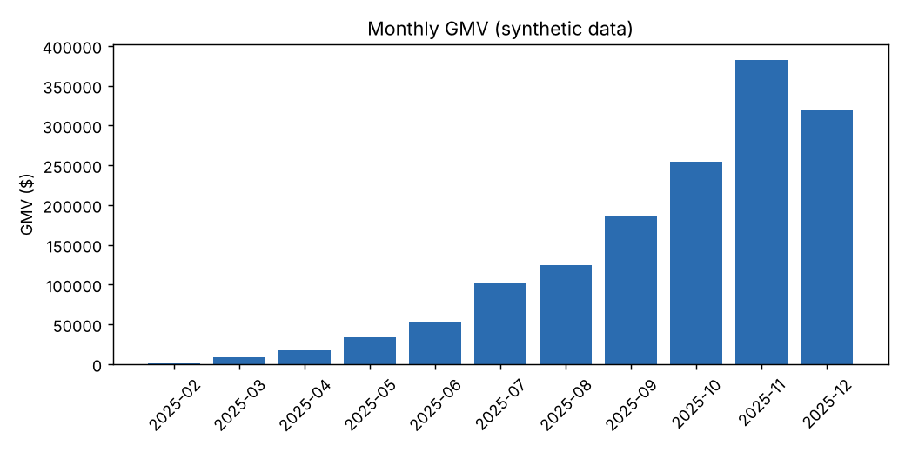
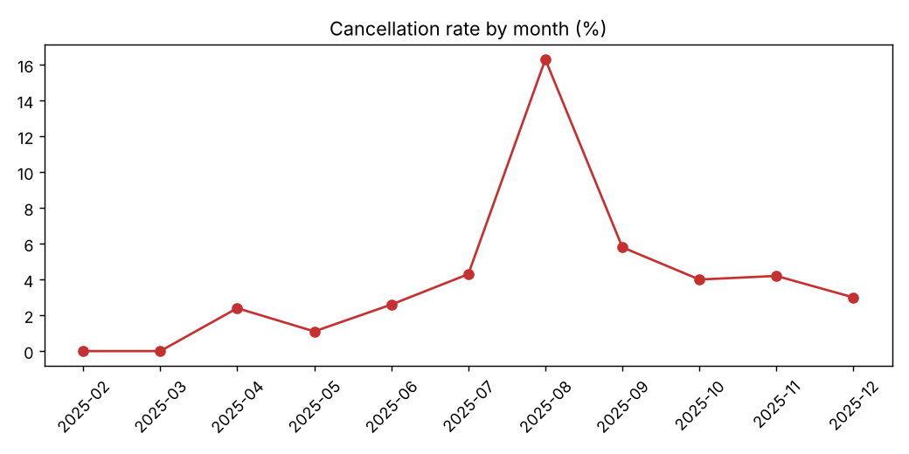
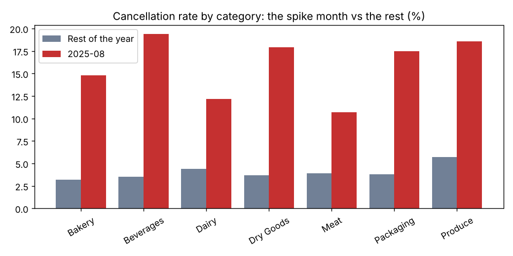
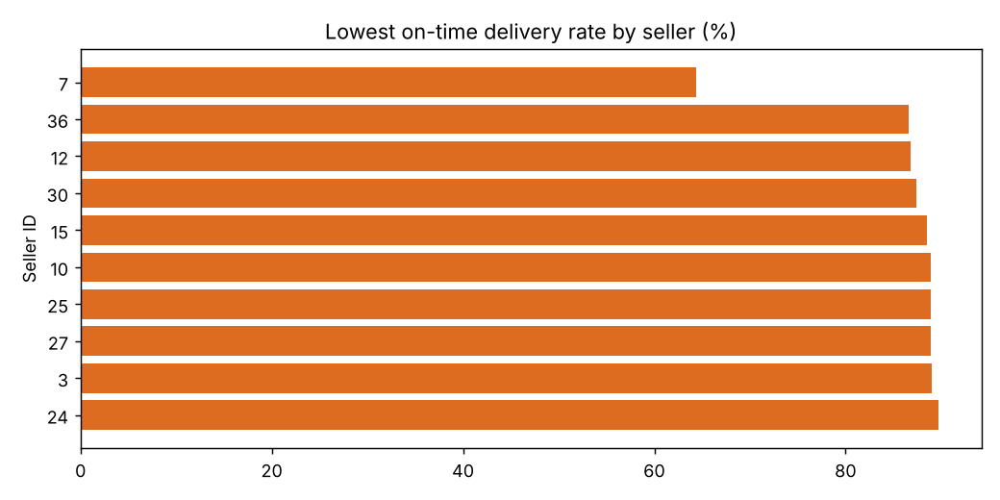
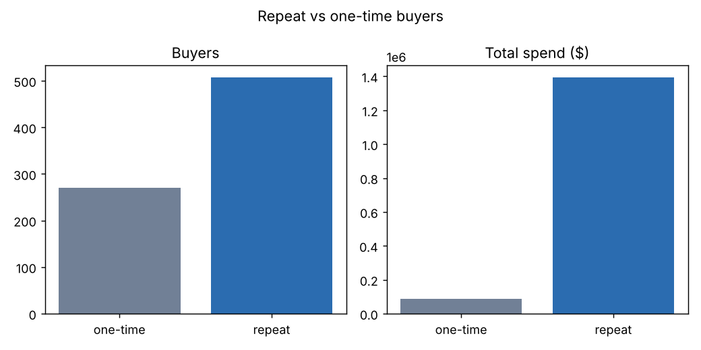
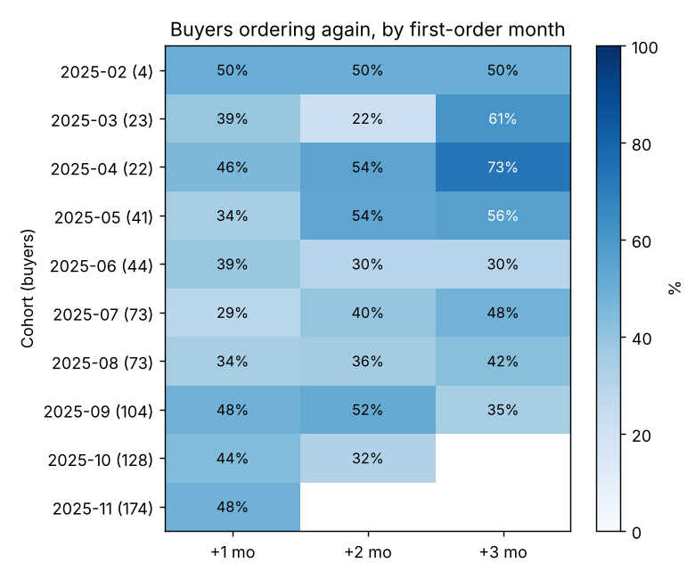
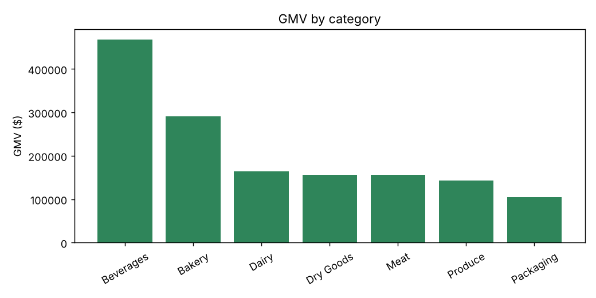

# Fulfillment Radar

[](https://github.com/Abhirup-code/Fulfillment-radar/actions/workflows/ci.yml)
[](LICENSE)

SQL and Python analytics for a B2B food-supply marketplace: monthly revenue, order value, cancellations, seller delivery performance, and repeat-buyer behavior.

**The data is synthetic.** I generated it with a script (`src/generate_data.py`) and built a few patterns in on purpose, so the analysis has something to find. Nothing comes from a real company. The project shows the method: define KPIs in SQL, check them with tests, and turn the numbers into recommendations.

## Key findings

From [`reports/FINDINGS.md`](reports/FINDINGS.md), on the synthetic data:

1. **Cancellations spiked to 16.3% in August 2025**, against about 3% normally, and the rate rose in
   every region and category at once. That points to a marketplace-wide cause, not one bad seller.
2. **Only 1 of 40 sellers is reliably late** (seller 7, on time 64% of the time). 15 others look low
   in a ranking but are too close to call once you account for sample size.
3. **Repeat buyers are 65% of buyers but 94% of spend**, and only about **42%** of new buyers order
   again the next month. The second order is the biggest lever.

## What it answers

| Question | Where |
|---|---|
| How are GMV, orders, and average order value trending? | `sql/kpis.sql` (monthly_kpis) |
| When did cancellations spike? | cancellation_rate_by_month |
| Was the spike one region or category, or everywhere? | cancellation_drilldown |
| Which sellers deliver late? | seller_on_time |
| Which of them are really below target, not just unlucky? | seller_flags (95% confidence intervals) |
| Do repeat buyers matter more than one-time buyers? | repeat_vs_one_time |
| Do new buyers come back 1, 2, and 3 months later? | cohort_retention |
| Which categories earn the most? | category_performance |

Results are written to `reports/` as CSV files, charts, and a short written summary in [`reports/FINDINGS.md`](reports/FINDINGS.md).

## Charts















## Run it

```bash
pip install -r requirements.txt
python src/generate_data.py      # writes data/*.csv (seeded, so the output is repeatable)
python -m src.analyze            # loads SQLite, runs the SQL, writes reports/
python -m pytest -v              # 29 tests
```

## Tests and checks

Before any KPI is computed, `src/validate.py` checks the raw data: duplicate ids, zero or negative
amounts, unknown statuses, delivery times that don't match the status, orders from unknown buyers or
sellers, unreadable dates, and orders placed before the buyer signed up. If anything fails, no reports
are written.

The tests check that the data is deterministic, that GMV from the SQL matches the raw CSV, that each data
check fires on bad rows, that the drill-down and cohort numbers match an independent pandas recount, that
the confidence intervals match known values, and that the built-in patterns are found.

CI runs ruff, rebuilds the data and reports, fails if the committed CSVs or findings no longer match the
code, and runs the tests with a 90% coverage floor.

## Definitions

- **GMV / AOV** exclude cancelled orders.
- **On-time** means delivered within the promised number of days. The target is 85%.
- **Below target** means even the top of a seller's 95% Wilson confidence interval is under 85%.
  Sellers whose interval includes 85% are "too close to call", not flagged.
- **Repeat buyer** means two or more non-cancelled orders.
- **Cohort** means the month of a buyer's first non-cancelled order. Retention compares only cohorts
  of 20 or more buyers, because smaller ones swing too much.

## License

[Apache 2.0](LICENSE). Copyright 2026 Abhirup Khan.
